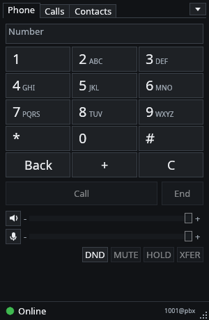
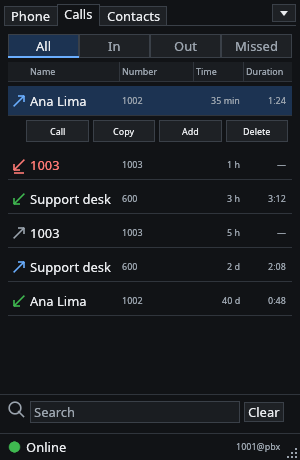
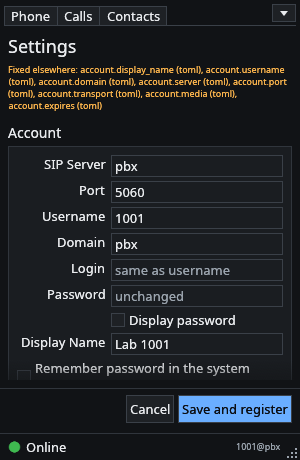
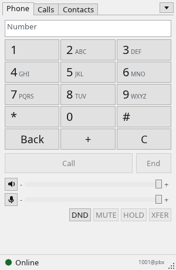
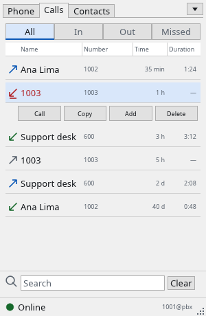
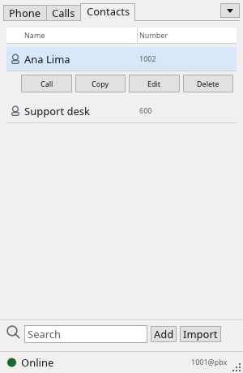

<div align="center">


# rust-microsip

**A fast, native SIP softphone for Linux, written in Rust, with the compact MicroSIP layout you already know.**

[](https://github.com/jniltinho/rust-microsip/releases)
[](https://github.com/jniltinho/rust-microsip/actions/workflows/ci.yml)
[](LICENSE)

[Install](#install) · [Quick start](#quick-start) · [Screenshots](#screenshots) · [CLI and MCP](#cli-and-mcp) · [Build](#build-from-source) · [Docs](#documentation)

</div>

## Why rust-microsip

MicroSIP is loved for being small, fast and simple, but it is a Windows program. rust-microsip
brings the same idea to the Linux desktop as one native binary: no Wine, no Electron, no webview, no
database server. It starts in a fraction of a second, takes little memory, and follows the familiar
layout of keypad, call log, contacts and a status bar that shows whether you are **Online**.

Calls are encrypted when your PBX supports it (TLS signaling with SRTP), passwords can stay in the
desktop keyring, and AI agents can place or answer calls through a local CLI and an MCP server only
with your explicit approval.

rust-microsip is an independent project inspired by [MicroSIP](https://www.microsip.org/). It is not
affiliated with or endorsed by MicroSIP.

## Features

| Area | What you get |
|---|---|
| **Calls** | One SIP account over UDP, TCP or TLS; G.711 (PCMU/PCMA); hold, mute, blind transfer, DND; RFC 4733 DTMF; early media, so messages the PBX plays before the answer are heard; local ringback tone |
| **Security** | TLS with system or custom CA; SDES-SRTP/SRTCP, optional or mandatory, with downgrade refusal; the password never goes in arguments, logs or the database |
| **Interface** | MicroSIP-like window: keypad, Logs-style call history (double-click to call back), contacts with favorites and CSV import, status bar with an Online icon; dark and light themes |
| **Desktop** | Tray icon whose menu redials your last calls; closing the window keeps it in the tray; incoming-call notifications with Answer/Reject; `sip:`/`tel:` link handler; single instance |
| **Audio** | ALSA, PipeWire and PulseAudio through the system's default devices; audio test with microphone level; devices opened only during calls |
| **Configuration** | Settings in the window, or TOML, `.env` and environment with a clear precedence; `--doctor` shows where every value came from without secrets |
| **Agents** | `rust-microsip` CLI and `mcp --stdio`: every action waits for **Allow** in the window unless you issue a scoped, revocable grant; a headless `service` mode |
| **Diagnostics** | `RUST_MICROSIP_TRACE=1` prints SIP status codes, SDP shape and media counters, without numbers or credentials |

Status: **pre-release** ([latest](https://github.com/jniltinho/rust-microsip/releases)). Calls, audio and
desktop integration are tested against a disposable Asterisk lab and on clean Ubuntu 24.04/26.04, Fedora 44
and Arch Linux desktops. A Windows build is in progress. See the [roadmap](docs/README.md).

## Screenshots

<table>
  <tr>
    <th>Keypad (dark)</th>
    <th>Call log (dark)</th>
    <th>Settings (dark)</th>
  </tr>
  <tr>
    <td></td>
    <td></td>
    <td></td>
  </tr>
  <tr>
    <th>Keypad (light)</th>
    <th>Call log (light)</th>
    <th>Contacts (light)</th>
  </tr>
  <tr>
    <td></td>
    <td></td>
    <td></td>
  </tr>
</table>

All screens use fictional data. More captures, in both themes and at 150% and 200% scaling, are in
[docs/prints/parity](docs/prints/parity/README.md).

## Install

Download from the [releases page](https://github.com/jniltinho/rust-microsip/releases):

- `rust-microsip-<version>-x86_64.AppImage`: make it executable and run it. It does not need `libfuse2`.
- `rust-microsip-<version>-x86_64`: the same program as a plain ELF.

Verify the download with `sha256sum --check --strict SHA256SUMS`.

Requirements: x86_64 Linux with glibc 2.39 or newer (Ubuntu 24.04, Fedora 40, Debian 13, Arch and
later), `libasound.so.2` and, on X11, `libxkbcommon-x11`. Standard GNOME and KDE desktops already have
them; a minimal Xfce install may need `libxkbcommon-x11`.

## Quick start

1. Start rust-microsip and open **▼ → Settings**.
2. Fill in **SIP Server**, **Username**, **Domain** and **Password**, and pick UDP, TCP or TLS. Tick
   "Remember password in the system keyring" to keep it across restarts.
3. Press **Save and register**. The status bar turns green: **Online**.
4. Type a number and press **Call**, or double-click an entry in **Calls**.

Choose your headset in your desktop's sound settings and keep "System default" in rust-microsip.

Prefer a file? Create `$XDG_CONFIG_HOME/rust-microsip/config.toml` (mode 0600):

```toml
schema = 1

[account]
username = "1001"
domain = "sip.example.invalid"
server = "sip.example.invalid"
transport = "tls"        # udp | tcp | tls
media = "srtp"           # rtp | srtp (srtp requires tls)
password_env = "RUST_MICROSIP_SIP_PASSWORD"
```

Export the password in that environment variable before starting; passwords are never accepted as
command-line arguments. `rust-microsip --doctor` prints a sanitized report of the effective
configuration, and `rust-microsip config validate` and `config export` check and print it without
secrets.

## CLI and MCP

While the window runs, other local programs can drive it:

```sh
rust-microsip status
rust-microsip call dial 1002      # waits for "Allow" in the window
rust-microsip mcp --stdio         # MCP server for AI agents
```

Every change waits for **Allow** in the window, unless you issued a scoped, time- and quota-limited
grant in **Settings → Agent access**. `rust-microsip service` runs without a window from a
single-use bootstrap exported there. See [Controlling rust-microsip](docs/agent-cli-mcp.md).

## Build from source

Only Docker with BuildKit is needed; Rust runs inside a pinned builder image, never on the host.

```sh
make dist                  # ELF, AppImage, SHA256SUMS, notices and SBOM in dist/
make check                 # fmt, clippy, tests, rustdoc
make suite                 # end-to-end calls against a disposable Asterisk lab
make windows               # Windows test build (preview)
```

The [development guide](docs/DEVELOPMENT.md) covers the layout, the lab and the release process.

## Documentation

- [Roadmap and receipts](docs/README.md): what is done, with evidence, and what remains.
- [Architecture](docs/architecture.md): crate layers from the domain to the window.
- [Controlling rust-microsip](docs/agent-cli-mcp.md): CLI, MCP, grants and the headless service.
- [Development guide](docs/DEVELOPMENT.md) and [release process](docs/release.md).
- OpenSpec changes: [Linux release](openspec/changes/create-native-rust-linux-release/proposal.md),
  [agent CLI/MCP](openspec/changes/add-agent-cli-mcp/proposal.md),
  [MicroSIP-like UI](openspec/changes/refine-native-ui/proposal.md),
  [Windows port](openspec/changes/add-windows-port/proposal.md).

## License

GPL-3.0-or-later. Third-party notices ship with every release. The MicroSIP name is used only to
describe the interface this project is inspired by.
