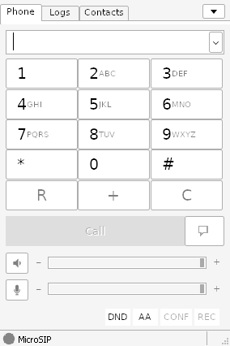
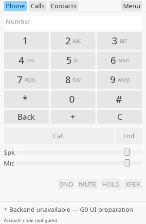
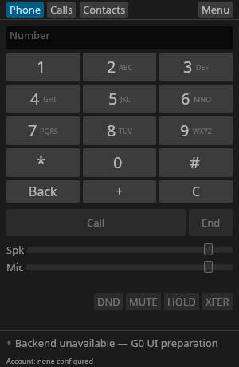
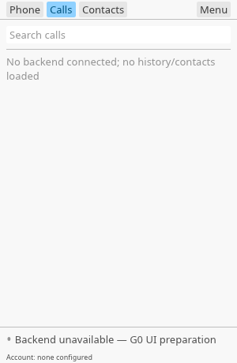
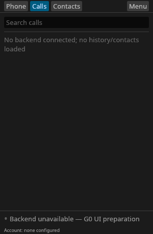
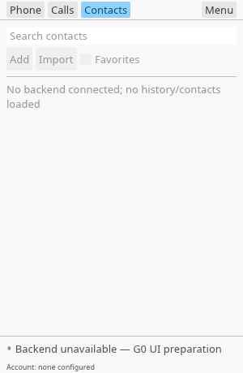
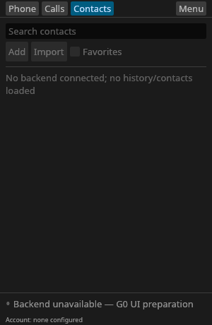

# Native UI screenshots and MicroSIP reference

These are **actual application-window captures**, not generated images or HTML mockups. The Rust screenshots show a **non-dialing G0 prototype**: no account, microphone, real call, contacts, or history is connected. Disabled controls and the backend-unavailable status are intentional. Main progress remains **4/54** verified tasks; linked CLI/MCP **0/14**. This is visual feedback, not task 1.8 or release acceptance.

## Compare the initial dialpad

| MicroSIP Lite 3.22.16 reference | Rust G0 native prototype, light |
| --- | --- |
|  |  |

Read the [MicroSIP capture provenance and attribution](microsip-reference.md). Its client area is **284 x 426 pixels**; Rust's is **300 x 460 pixels**. Files retain their captured dimensions, without resizing or compositing. Different native/Wine widgets, fonts, window sizes and display metrics make this a hierarchy/density comparison, **not pixel equivalence** or a human-approved visual matrix.

**Layout revision 2:** the Rust window now follows MicroSIP's structure: tab strip with a right-aligned menu button, full-width number field, 4 x 3 keypad with inline letters, a Back / + / C edit row, a wide disabled Call button with a smaller End button, disabled speaker/microphone level rows, compact disabled DND / MUTE / HOLD / XFER buttons, and a bottom status bar. The initial Dialpad fits without scrolling. Text labels replace MicroSIP's icons because the reviewed font lacks those symbols and no icon asset has been reviewed. Disabled controls show their full "(unavailable)" label on hover. The density is still a candidate, not human-approved fidelity, and is below the earlier 44-point target size; scaling/accessibility gates remain open.

## Rust tabs in both themes

| Tab | Light | Dark |
| --- | --- | --- |
| Dialpad |  |  |
| Calls |  |  |
| Contacts |  |  |

## How the Rust pixels were captured

- Actual egui/eframe **0.36.2**, wgpu **30.0.0** native X11 window; source: [`tests/probes/ui_spike.rs`](../../tests/probes/ui_spike.rs).
- Exact standalone **non-Tokio** dependency tree received a bounded precompile license/source/native-boundary review. Offline pinned Rust **1.99.0** compilation, **16/16** native-feature tests and own-code warnings-as-errors succeeded. No production dependency policy was changed.
- Isolated snapshot-pinned Ubuntu test container, private **Xvfb at 96 DPI**, configured **GLES/llvmpipe software rendering**, no window manager. Captures are the **300 x 460** client area at one pixel per logical point, not desktop decorations. No dedicated GPU/device was passed through.
- No network, host HOME/settings, host display/X socket, D-Bus, audio or GPU/device mounts; non-root, read-only root filesystem, dropped capabilities, private temporary HOME/runtime/display. Environment-selected bus/process/loader/compiler injection was cleared.
- Strict `--preview-tab` / `--preview-theme` flags select empty presentation state. `xwd` captured real window pixels; ImageMagick encoded PNG losslessly. No scaling, cropping, retouching, recoloring, overlays or substituted content. All six final images were visually inspected. Revision 2 reused the same reviewed manifest, isolated lockfile and capture script; only presentation code changed, and no crate or version was added.
- The reviewed unmodified Noto Sans font and complete OFL-1.1 notices are retained in [`ui-assets`](../../tests/probes/ui-assets/source.json). Font license is accessible through the prototype's `--font-license` and Settings.

Exact source/build/review identities and per-image SHA-256 are in [`capture.json`](capture.json). The local binary, cache, container, raw XWD, logs and review-notice corpus are ignored test artifacts, **not published application deliverables**.

## Gates these screenshots do not satisfy

This preview has no production audio, notifications or authenticated IPC stack. The AccessKit async-io plus future Tokio integration blocker remains open. It is not the required same-stack G0 ELF, clean GNOME/Wayland or KDE/X11 test, accessibility/keyboard/contrast/scaling approval, microphone/hotplug test, real two-way-audio call, corresponding-source/notice export acceptance, or usable release. See the [G0 UI boundary and outstanding gates](../ui/g0-native-ui.md).

MicroSIP is an independent upstream reference, not an affiliation or endorsement. No upstream executable, icon, font, source, or application asset is incorporated into the Rust UI by this comparison.
