# Screen captures

The rust-microsip window as of the MicroSIP-like interface (OpenSpec change
[refine-native-ui](../../../openspec/changes/refine-native-ui/tasks.md), tasks 5.2 to 5.4).
Everything shown is fictional: lab account 1001@pbx, invented contacts and calls. The
captures were taken from the window at 100%, and `-x1.5`/`-x2` mark 150% and 200% scaling.

| File | Capture |
| --- | --- |
| `rms-calls-dark.png` | 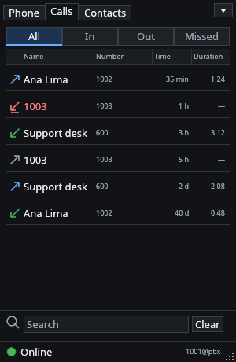 |
| `rms-calls-light.png` |  |
| `rms-calls-menu-dark.png` | 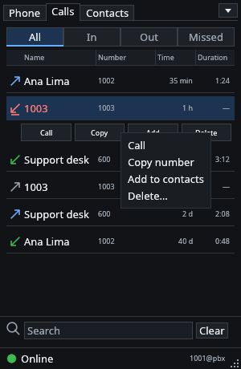 |
| `rms-calls-menu-light.png` | 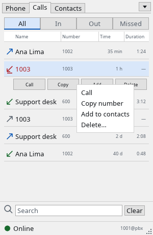 |
| `rms-calls-selected-dark-x1.5.png` | 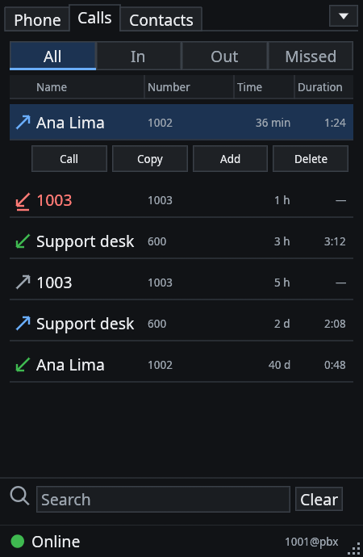 |
| `rms-calls-selected-dark-x2.png` | 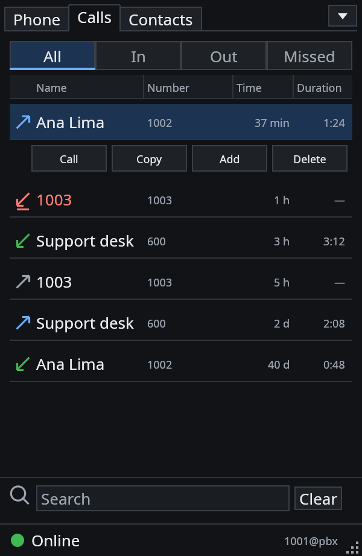 |
| `rms-calls-selected-dark.png` |  |
| `rms-calls-selected-light.png` | 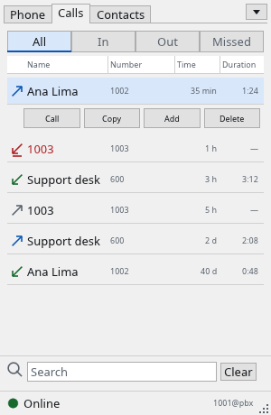 |
| `rms-contacts-dark.png` | 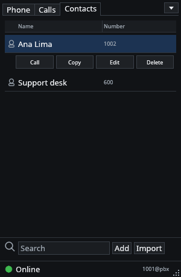 |
| `rms-contacts-light.png` |  |
| `rms-phone-dark-x1.5.png` | 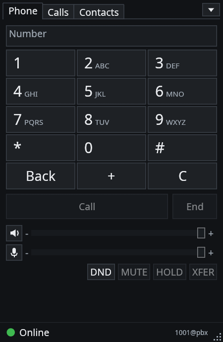 |
| `rms-phone-dark-x2.png` | 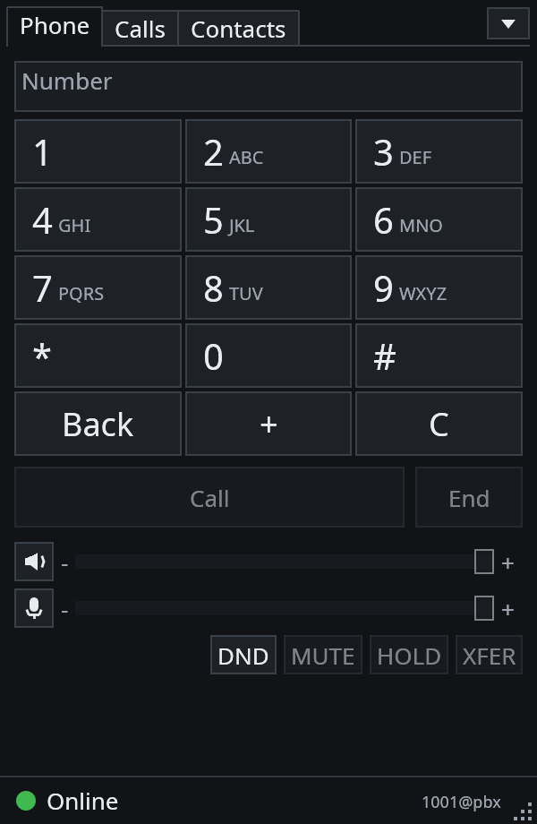 |
| `rms-phone-dark.png` |  |
| `rms-phone-light.png` |  |
| `rms-settings-dark-x1.5.png` | 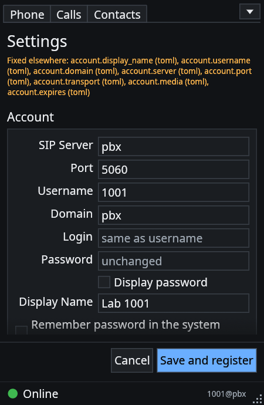 |
| `rms-settings-dark-x2.png` | 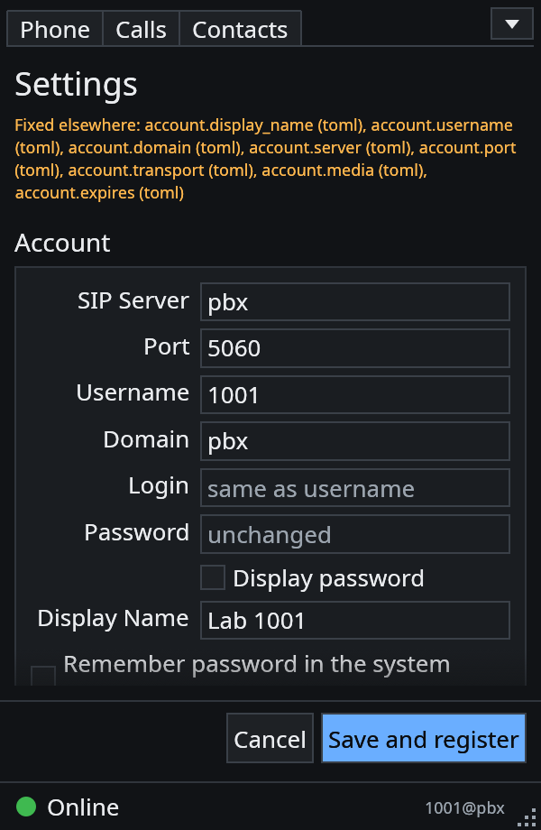 |
| `rms-settings-dark.png` |  |
| `rms-settings-full-dark.png` | 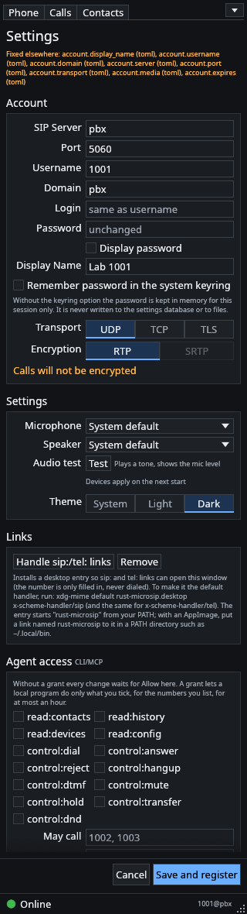 |
| `rms-settings-full-light.png` | 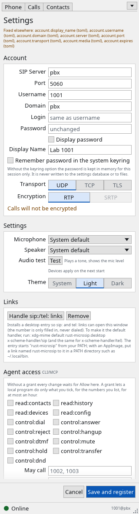 |
| `rms-settings-light.png` | 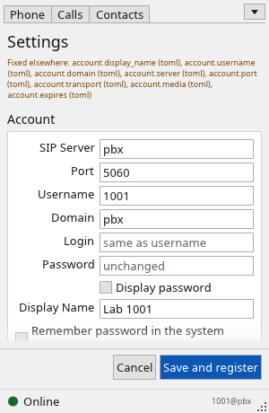 |
| `rms-status-dnd-dark.png` | 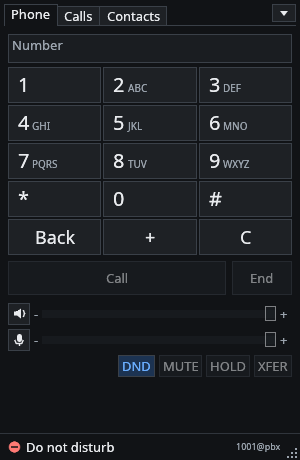 |
| `rms-status-dnd-light.png` | 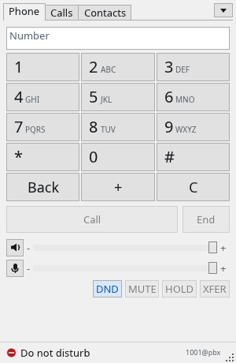 |
| `rms-status-error-dark.png` | 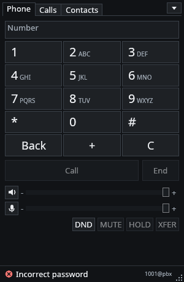 |
| `rms-status-error-light.png` | 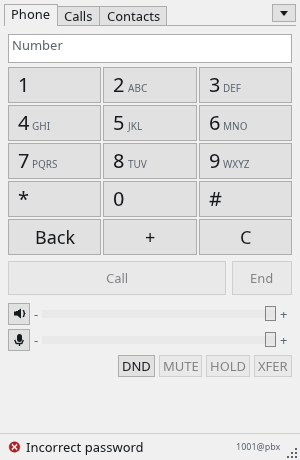 |
| `rms-status-offline-dark.png` | 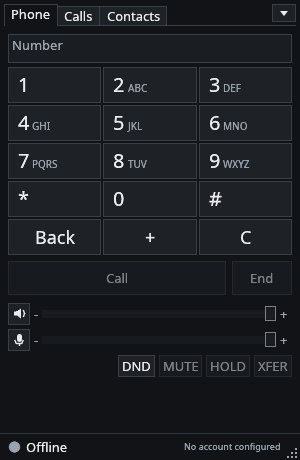 |
| `rms-status-offline-light.png` | 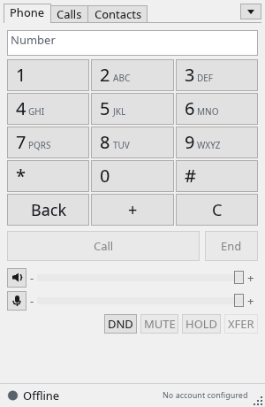 |
