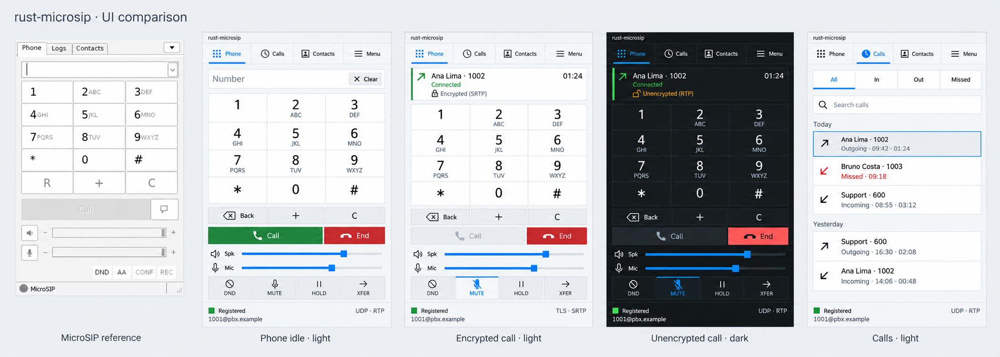
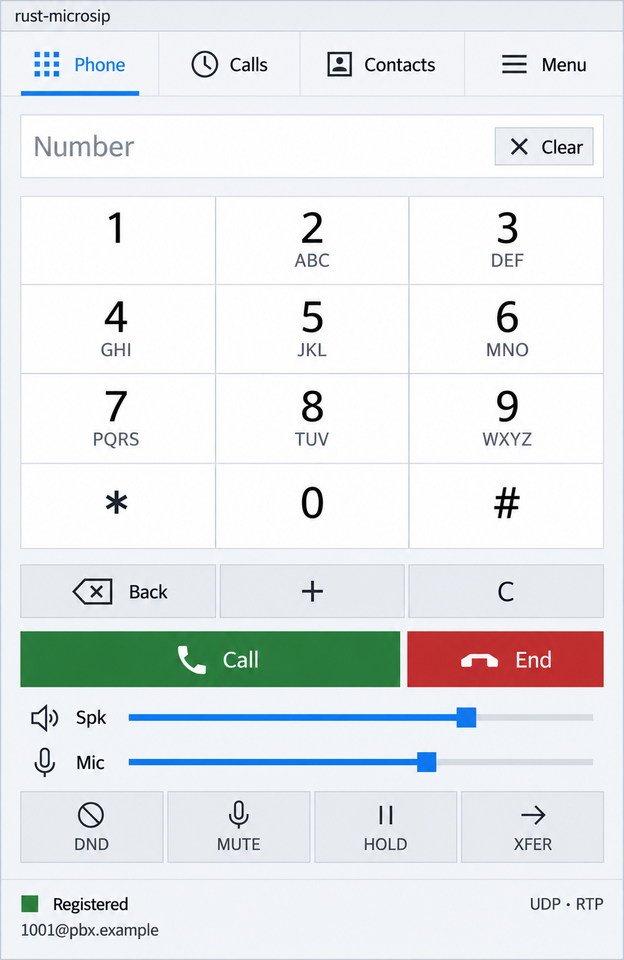
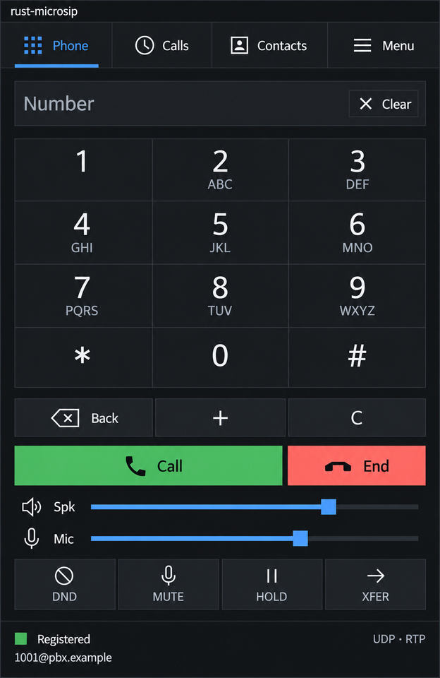
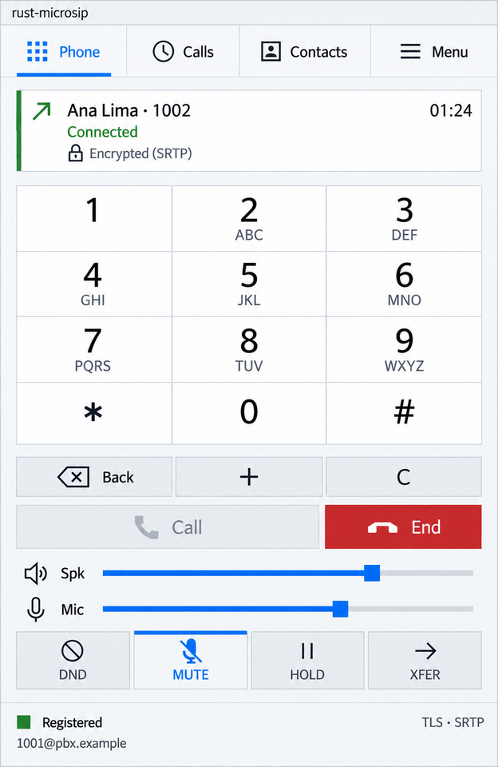
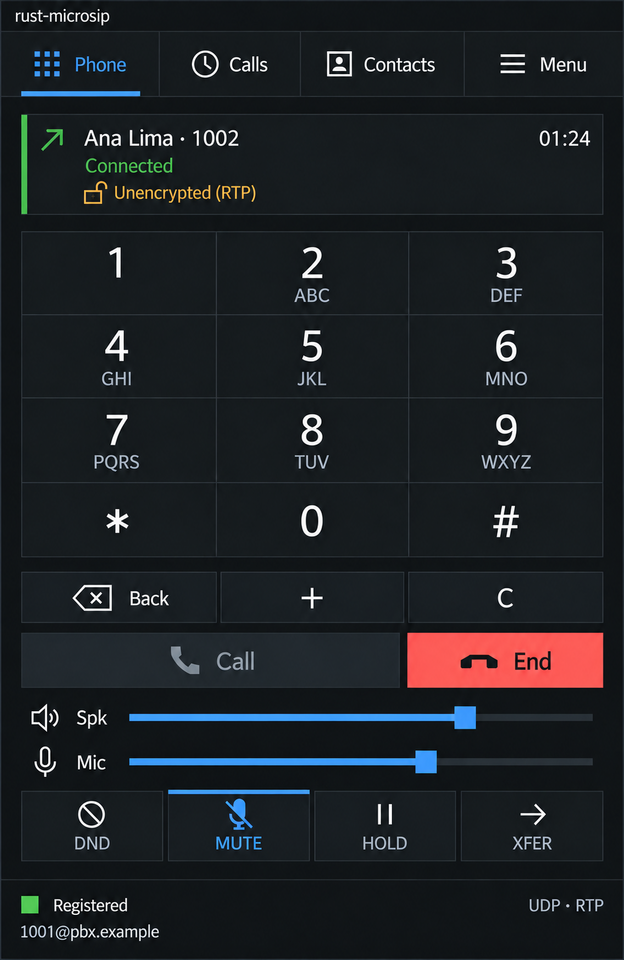
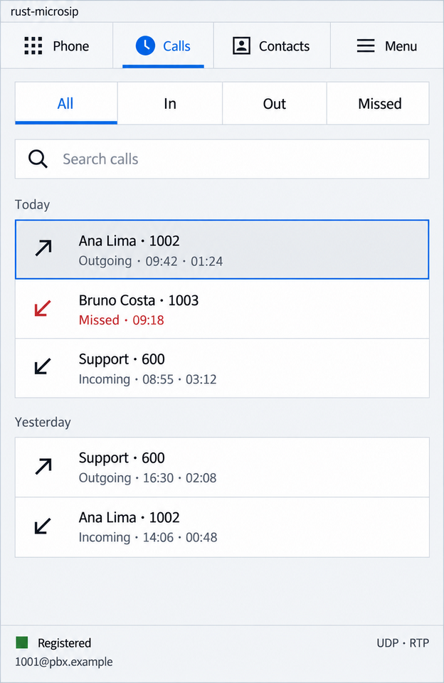
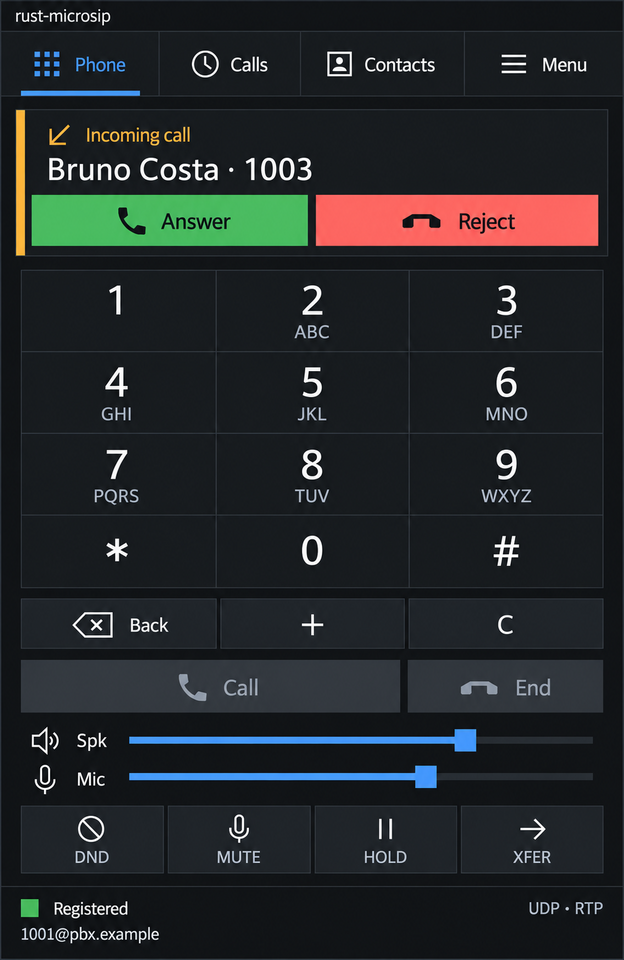
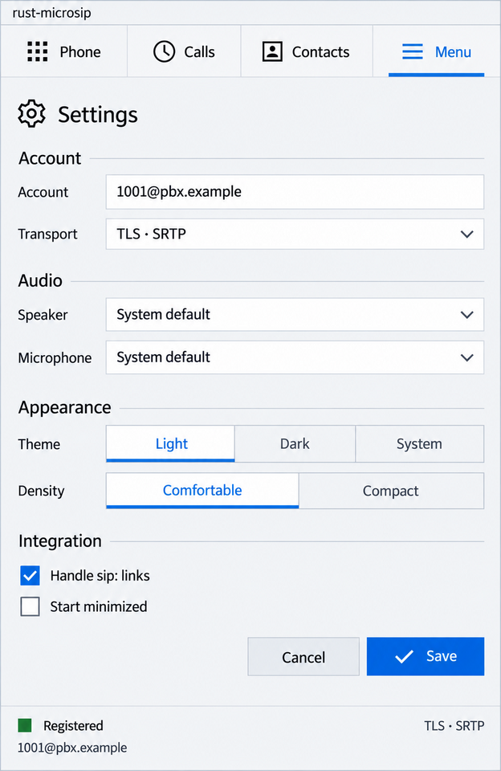
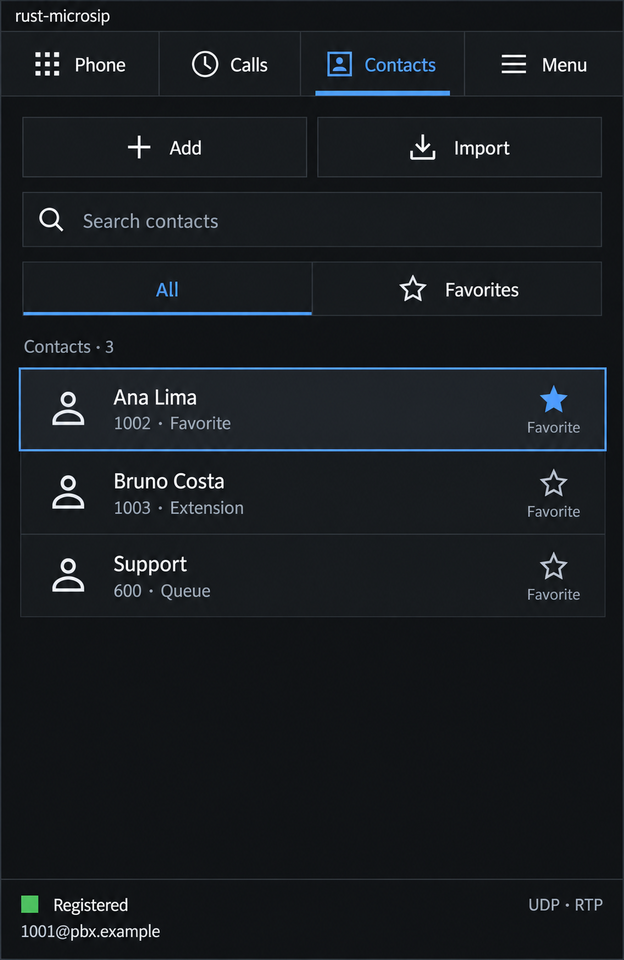

# UI refinement concept mockups

**These are generated concept images, not captures of the application.** They were produced with the Codex CLI's image generation from the [refine-native-ui design](../../../openspec/changes/refine-native-ui/design.md), the [MicroSIP reference capture](../microsip-reference.png) and two captures of the current app ([prompt](codex-prompt.txt)). All names, numbers and the account are fictional. Text, icon shapes and spacing are approximations: the implementation follows the design tokens, not these pixels, and the real window is accepted through lab captures (tasks 4.1–4.2 of the proposal). Status: **awaiting the owner's approval** (task 1.1).

| Light | Dark |
| --- | --- |
|  |  |
|  |  |
|  |  |
|  |  |

Checksums: [SHA256SUMS](SHA256SUMS).
